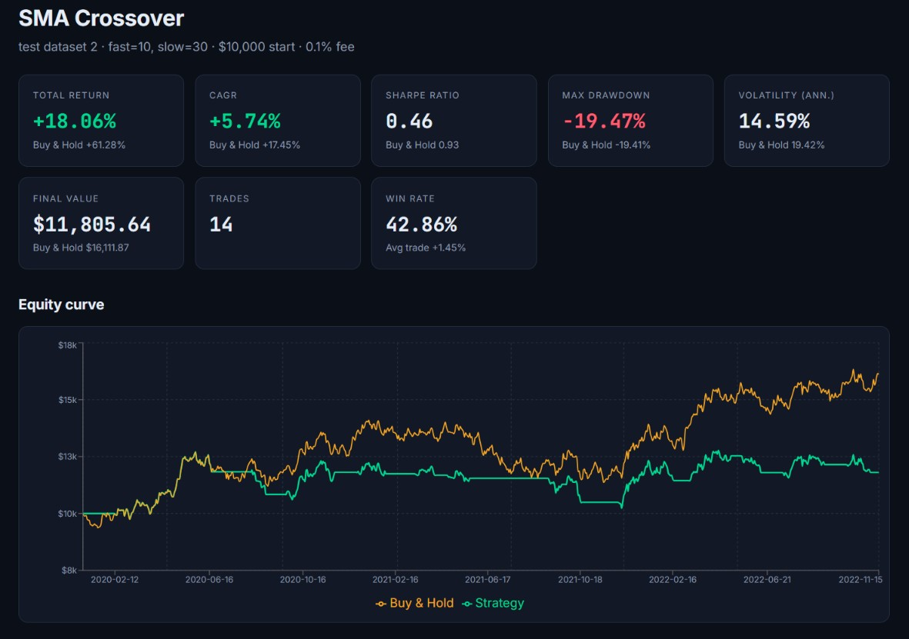
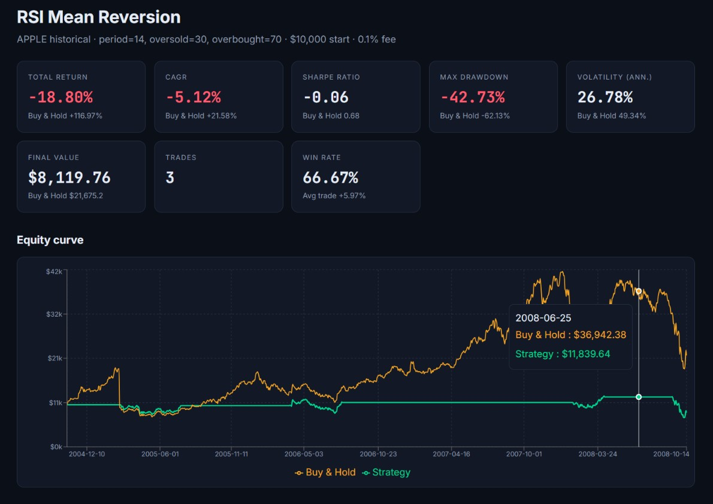
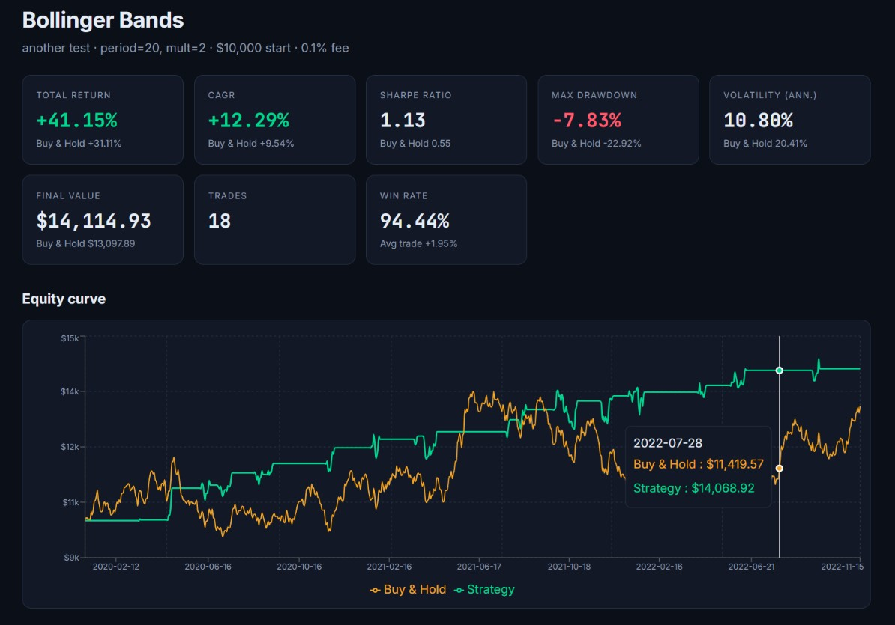

# QuantLab: Strategy Backtesting & Risk Analysis Platform

**A full-stack MERN application that lets anyone test a trading idea on historical or simulated market data, and see honestly how it would have performed, before risking a single rupee.**

[Live App](https://quantlab-drab.vercel.app/) · [Demo Video](https://drive.google.com/file/d/1DCd7EjVkzIYcPB7nGGfMGeHleaPldFp4/view?usp=sharing) · [API Health](https://quantlab-bzr6.onrender.com/api/health) · [Source](https://github.com/sovmya/quantlab)


## Screenshots

### SMA Crossover Strategy


### RSI Strategy


### Bollinger Bands Strategy


---

## What is this?

A trading strategy is a set of rules, such as "buy when the short-term trend crosses above the long-term trend, sell when it crosses back". A **backtest** replays those rules over past prices to estimate how the strategy would have done.

Most beginner backtests are misleading. They ignore trading fees, quietly use tomorrow's information to make today's decision, and judge success by profit alone. QuantLab is built to avoid those mistakes by design. It makes every assumption explicit, compares each strategy against a simple Buy & Hold benchmark, and reports risk alongside return.

## Try it in 2 minutes

> The backend runs on a free tier that sleeps when idle. Open the [health link](https://quantlab-bzr6.onrender.com/api/health) first and wait about 50 seconds if it is slow. After that everything is fast.

1. **Register** an account. You land on an empty dashboard.
2. Go to **Datasets → Generate (GBM)**. The defaults are fine. This creates a simulated market.
3. Click **+ New Backtest**, pick **SMA Crossover**, and run it.
4. Read the result page: metric cards, the equity curve against Buy & Hold, and the full trade log.
5. Run **RSI** and **Bollinger Bands** on the same dataset, then compare them on the **Backtests** page.
6. Optional: download historical prices for any stock from Yahoo Finance as CSV and use **Upload CSV** to test on real data.

## Features

**Data**
- Seeded Geometric Brownian Motion generator. The same seed always produces the same market, so experiments are reproducible.
- CSV upload (Yahoo Finance style, `Date` and `Close` columns) with row-by-row validation.

**Strategies** (parameters validated server-side, forms built dynamically from the server's strategy definitions)

| Strategy | Idea |
|---|---|
| SMA Crossover | Hold while the fast moving average is above the slow one |
| RSI Mean Reversion | Buy when oversold, sell when overbought (Wilder's smoothing) |
| Bollinger Bands | Buy below the lower band, sell on return to the middle band |

**Analysis**
- Total return, CAGR, annualised volatility, Sharpe ratio, maximum drawdown, win rate, average trade return, trade count
- Every metric shown next to the Buy & Hold benchmark
- Equity-curve chart and a full trade log (open positions are marked)

**History**
- Every run is saved per user, and can be reopened, compared and deleted
- A backtest keeps a snapshot of its dataset's name, so it survives deleting the dataset

## How the backtest engine works

The engine is independent of Express, so it can be tested on its own.

```
prices ──► strategy generates signals ──► engine simulates trades ──► metrics
          (hold = 1, cash = 0)           (fees, delay, positions)     (risk + return)
```

**No look-ahead bias.** A signal computed from day *t*'s closing price is executed at day *t+1*'s close. The strategy never trades on information it couldn't have acted on. A unit test checks this exactly.

**Fees on every trade.** A percentage fee is charged on each buy and sell. The Buy & Hold benchmark pays its entry fee too, so the comparison is fair.

**Honest bookkeeping.** A position still open at the end is shown in the trade log, marked to market and flagged as open, and is excluded from win-rate statistics.

**Risk, not just profit.**

| Metric | Meaning |
|---|---|
| Total return | Overall gain or loss |
| CAGR | Return annualised as compound growth |
| Volatility | Annualised standard deviation of daily returns |
| Sharpe ratio | Return per unit of risk: mean ÷ std of daily returns × √252 (risk-free rate = 0) |
| Max drawdown | Largest peak-to-trough fall in portfolio value |
| Win rate / avg trade | Share of closed trades that were profitable, and their average return |

## Engineering highlights

**Security**
- Passwords hashed with bcrypt, hidden from every query by default (`select: false`), and never returned by the API
- JWT stored in an **HttpOnly** cookie (not readable by JavaScript), `Secure` in production, with identical flags used for set and clear
- Login compares against a dummy hash when the email doesn't exist, so response time doesn't reveal which emails are registered. The error message is generic too
- **Every query is scoped to the logged-in user** (`{ _id, user }`), so another user's data simply returns 404 and cannot be reached by guessing ids
- Strict type, range and ObjectId validation on all input, which blocks NoSQL-injection payloads like `{"$gt": ""}`
- Strategy lookup uses `Object.hasOwn`, so inputs like `"constructor"` can't reach prototype properties
- Rate limiting (30 login/register attempts and 600 API requests per 15 minutes per IP), Helmet security headers, 1 MB body limit, and per-user caps (20 datasets, 200 backtests)
- Secrets live only in environment variables. The server **refuses to start** if they are missing, and `.env` is never committed

**Reliability**
- One central error handler turns every failure into a clean JSON response. Server errors are logged internally and never leak stack traces
- Every page implements loading, error (with retry) and empty states
- Unit tests cover the indicators, the no-look-ahead rule, fee impact and drawdown

**Frontend**
- Context API holds auth state. The cookie is the source of truth, confirmed through `/auth/me` on load
- A `ProtectedRoute` wrapper guards every private page
- The API is called through `/api` in development (Vite proxy) and production (Vercel rewrite), so the session cookie is first-party and works even in browsers that block third-party cookies, with no CORS configuration

## Architecture

```
React (Vite) ──► /api ──► Express
                           ├─ middlewares   auth, error handling, rate limit, helmet
                           ├─ routes
                           ├─ controllers   validate input, orchestrate
                           ├─ services      strategies · indicators · backtest engine · data generator
                           └─ models        Mongoose ──► MongoDB Atlas
```

Controllers stay thin. The business logic lives in `services/`, which has no knowledge of HTTP.

## Tech stack

| Layer | Technology |
|---|---|
| Frontend | React, Vite, React Router, Context API, Axios, Recharts, CSS |
| Backend | Node.js, Express |
| Database | MongoDB (Atlas), Mongoose |
| Auth & security | JWT, HttpOnly cookies, bcrypt, Helmet, express-rate-limit |
| Testing | Node.js built-in test runner |
| Deployment | Vercel (frontend), Render (backend), MongoDB Atlas |

## Project structure

```
quantlab/
├── backend/
│   ├── config/         env validation, database connection
│   ├── controllers/    auth, dataset, backtest
│   ├── middlewares/    auth.middleware.js, error.middleware.js
│   ├── models/         user, dataset, backtest
│   ├── routes/
│   ├── services/       indicators, strategies, backtestEngine, dataGenerator
│   ├── tests/          engine.test.js
│   ├── utils/          asyncHandler, httpError, validate, generateToken
│   └── index.js
└── frontend/
    ├── vercel.json     API rewrite + SPA fallback
    └── src/            pages, components, context, services, utils
```

## Run it locally

**Requirements:** Node 18+ and a MongoDB Atlas cluster (or any MongoDB URI).

```bash
git clone https://github.com/sovmya/quantlab.git
cd quantlab/backend
npm install
cp .env.example .env     # then fill in the values below
npm test                 # runs the engine unit tests
npm run dev              # API on http://localhost:5000
```

In a second terminal:

```bash
cd quantlab/frontend
npm install
npm run dev              # app on http://localhost:5173
```

**Environment variables** (`backend/.env`)

| Variable | Description |
|---|---|
| `MONGO_URI` | MongoDB connection string (required) |
| `JWT_SECRET` | Long random string used to sign tokens (required) |
| `JWT_EXPIRES_IN` | Token lifetime, default `7d` |
| `PORT` | API port, default `5000` |
| `NODE_ENV` | `development` or `production` |

Generate a strong secret with:
`node -e "console.log(require('crypto').randomBytes(48).toString('hex'))"`

**Deploying:** run the backend on Render (root directory `backend`, start command `npm start`, same env vars with `NODE_ENV=production`). Run the frontend on Vercel (root directory `frontend`) and point the `destination` in `frontend/vercel.json` at your Render URL.

## API

All routes are under `/api`. Everything except register, login and logout requires a valid session cookie.

| Method | Endpoint | Purpose |
|---|---|---|
| POST | `/auth/register`, `/auth/login`, `/auth/logout` | Authentication |
| GET | `/auth/me` | Current user |
| GET | `/datasets` | List your datasets |
| POST | `/datasets/generate` | Create a synthetic (GBM) dataset |
| POST | `/datasets/upload` | Create a dataset from CSV rows |
| GET / DELETE | `/datasets/:id` | Read / delete a dataset |
| GET | `/backtests/strategies` | Strategy definitions and parameter specs |
| POST | `/backtests` | Run and save a backtest |
| GET | `/backtests` | List saved backtests |
| GET / DELETE | `/backtests/:id` | Read / delete a backtest |

## Methodology and assumptions

- **Execution:** signals at the close of day *t* are executed at the close of day *t+1*. This is a simulation convention, not a guarantee of real-world fills.
- **Portfolio:** single asset, long-only, fully invested or fully in cash. No short selling or leverage.
- **Costs:** a percentage fee on every buy and sell. Slippage and taxes are not modelled.
- **Annualisation:** 252 trading days per year; Sharpe uses a risk-free rate of 0.
- **Synthetic data:** GBM prices are for reproducible experiments and understanding how backtests behave. Good results on simulated data do not prove a strategy has a real-market edge.

## Limitations and future work

- Multi-asset portfolios and position sizing
- Short selling and additional execution models
- Parameter-grid optimisation and walk-forward testing to guard against overfitting
- Live or scheduled market-data ingestion
- Email verification and password reset, and revocable sessions (a JWT can't currently be invalidated before it expires)
- On the free hosting tier, all visitors reach the API through one proxy, so the IP-based rate limit is shared between them. A production setup would pass the real client IP through.

## Disclaimer

QuantLab is an educational and analytical tool, not investment advice. Historical and simulated results do not guarantee future performance.